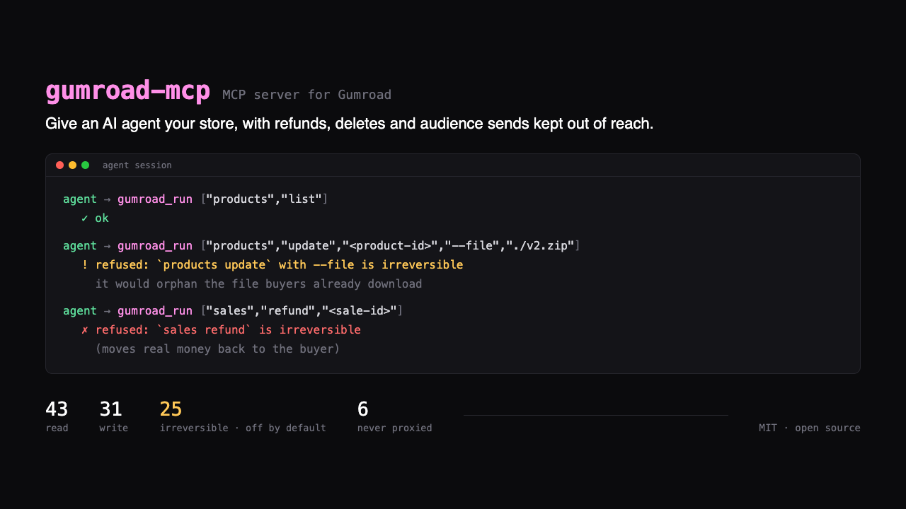
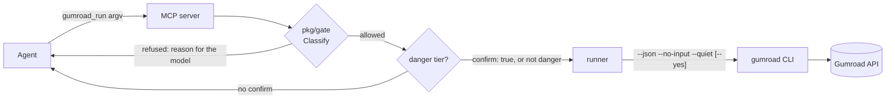

<div align="center">



# gumroad-mcp

An MCP server that gives AI agents safe access to a Gumroad store, and keeps irreversible commands out of their reach.

[](https://github.com/gshepptech/gumroad-mcp/actions/workflows/ci.yml)
[](https://pkg.go.dev/github.com/gshepptech/gumroad-mcp/pkg/gate)
[](go.mod)
[](https://github.com/gshepptech/gumroad-mcp/releases)
[](LICENSE)

</div>

gumroad-mcp drives the official [`gumroad` CLI](https://github.com/antiwork/gumroad-cli). It classifies all 99 of the CLI's commands into risk tiers and only offers an agent the tiers you enable. Refunds, deletes and customer emails stay unreachable unless you opt in, and even then each call needs an explicit confirmation.

Gumroad's CLI ships an agent skill that tells the model to add `--yes` to skip confirmation on deletes and refunds. That is advice, and a model can follow it. gumroad-mcp enforces the boundary in code instead: an agent cannot talk its way past a command it was never offered.

## Features

- **Every command classified.** 43 read, 31 write and 25 danger commands, plus 6 that are never proxied (`admin`, `auth login`, `auth logout`, `auth token`, `skill`, `completion`).
- **Strict allowlist.** A command missing from the policy is refused, so a new upstream subcommand stays unreachable until someone classifies it.
- **Flag-aware tiers.** A flag can promote a command: `products update --file` is danger, because it orphans files buyers already download.
- **Two-step danger.** `--allow-danger` exposes the tier, and each call still needs `confirm: true`.
- **Previews always work.** `--dry-run` sends nothing to Gumroad, so it is allowed under every posture except for never-proxied commands.
- **Read-only terminal UI** over products, sales, subscribers, emails and payouts.
- **Reusable gate.** The classifier is a standalone package, [`pkg/gate`](https://pkg.go.dev/github.com/gshepptech/gumroad-mcp/pkg/gate), with no Gumroad code in it.

## Quick start

Install the Gumroad CLI and log in. gumroad-mcp shares that session and stores no credential of its own.

```sh
brew install antiwork/cli/gumroad
gumroad auth login
```

Install gumroad-mcp from [releases](https://github.com/gshepptech/gumroad-mcp/releases), or with Go:

```sh
go install github.com/gshepptech/gumroad-mcp/cmd/gumroad-mcp@latest
gumroad-mcp doctor
```

```console
$ gumroad-mcp doctor
✓ gumroad found at /opt/homebrew/bin/gumroad
✓ version 2026.08.13
✓ authenticated

policy
  43 read  31 write  25 irreversible  6 never proxied
```

Register it with Claude Code:

```sh
claude mcp add gumroad -- gumroad-mcp mcp
```

Or with any MCP host:

```json
{
  "mcpServers": {
    "gumroad": { "command": "gumroad-mcp", "args": ["mcp"] }
  }
}
```

## How it works



### Tiers

| Tier | Meaning | Count | Default |
|---|---|---:|---|
| read | cannot change anything | 43 | on |
| write | undoable from the Gumroad dashboard | 31 | on |
| danger | irreversible, moves money, or reaches a customer | 25 | off |
| forbidden | never proxied: `admin`, `auth login`, `auth logout`, `auth token`, `skill`, `completion` | 6 | never |

### How the gate decides

`Policy.Classify` in [`pkg/gate/gate.go`](pkg/gate/gate.go) takes the argv and the server's posture and returns a decision with a reason written for the model to act on:

1. **Find the command.** The leading words before the first flag are the command. Arguments can never change which command runs.
2. **Check forbidden prefixes.** A forbidden entry blocks everything beneath it, so `admin` covers every `admin ...` subcommand.
3. **Longest-prefix match** against the allowlist. No match means refused.
4. **Apply danger flags.** If the argv carries a flag the command lists in `DangerFlags`, the tier becomes danger.
5. **Decide**, in this order:
   - forbidden is refused, even as a preview;
   - a `--dry-run` preview is allowed;
   - under `--read-only`, anything above read is refused;
   - danger is refused unless `--allow-danger` is set;
   - everything else is allowed.

The MCP layer then adds the confirmation step. A danger call without `confirm: true` is refused with a message asking the model to preview it or get the user's go-ahead. The runner appends `--json`, `--no-input` and `--quiet` to every call, and `--yes` only after the gate has passed. A caller that passes any of those flags itself is refused.

The policy has a test, `TestPolicyCoversTheInstalledCLI`, that walks the installed `gumroad` binary's command tree and fails if any command is unclassified. It skips when `gumroad` is not installed, as in CI.

## Usage

### Server postures

```sh
gumroad-mcp mcp                 # read + write
gumroad-mcp mcp --read-only     # nothing can change the account
gumroad-mcp mcp --allow-danger  # adds refunds, deletes, audience sends
```

### MCP tools

| Tool | Purpose |
|---|---|
| `gumroad_run` | Run a command, as an argv array. The main tool. |
| `gumroad_skill` | Gumroad's own reference for every command. |
| `gumroad_help` | A command's `--help`, for exact flags. |
| `gumroad_commands` | What this server will run, with tiers. |
| `gumroad_reviews` | Product reviews. The CLI has no command for this. |
| `gumroad_earnings` | Tax Center annual earnings. The CLI has no command for this. |
| `gumroad_tax_forms` | 1099s. The CLI has no command for this. |
| `gumroad_public_product` / `_profile` | Any seller's public data, unauthenticated. |

### Terminal UI

```sh
gumroad-mcp
```

Read-only tabs for Products, Sales, Subscribers, Emails and Payouts. `↑↓` move, `enter` opens a record, `tab` switches section, `s` on a product shows its subscribers, `q` quits.

### Flags that change the tier

`products update --name "New name"` is an ordinary edit. `products update --file ./new.zip` rewrites the content page to embed only the new upload, orphaning the file buyers already download, and rich content has no version history. The command table records that:

```go
{
    Path: []string{"products", "update"}, Tier: gate.Write,
    DangerFlags: []string{"--file", "--custom-html"},
    DangerFlagWhy: "--file rewrites the content page to embed ONLY the new upload, " +
        "orphaning files buyers already download (antiwork/gumroad-cli#205) …",
}
```

The underlying CLI behaviour is reported upstream as [antiwork/gumroad-cli#205](https://github.com/antiwork/gumroad-cli/issues/205).

### Using the gate for another CLI

```go
policy := gate.MustPolicy(commands, gate.WithPreviewFlags("--dry-run"))

d := policy.Classify(argv, readOnly, allowDanger)
if !d.Allowed {
    return errors.New(d.Reason)
}
```

[`internal/gumroadcli`](internal/gumroadcli/gumroadcli.go) is the Gumroad adapter: the command table, the flags to force, the flag that confirms, and how to read the CLI's error envelope. A different tool needs a sibling of that file. Gumroad's CLI makes this easy with a uniform `--json`, `--dry-run` and error envelope; tools without those need parsing code rather than a table.

## Development

Requires Go 1.26 or newer and [golangci-lint](https://golangci-lint.run/) v2.

```sh
make build   # bin/gumroad-mcp
make test    # go test -race ./...
make check   # fmt, lint, test
```

```
cmd/gumroad-mcp/     entrypoint
pkg/gate/            tiers, policy, classification, runner
internal/gumroadcli/ the Gumroad adapter: command table and runner config
internal/mcpsrv/     MCP tools and the confirmation step
internal/gumroad/    the API endpoints the CLI lacks
internal/tui/        terminal UI
internal/cli/        mcp, tui and doctor subcommands
```

Releases are built by GoReleaser when a `v*` tag is pushed.

## License

[MIT](LICENSE). Copyright (c) 2026 Garrett Sheppard.
